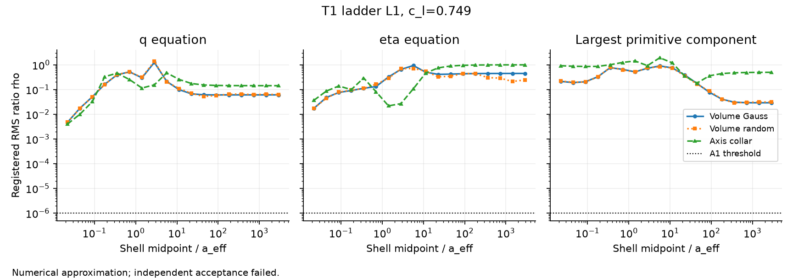
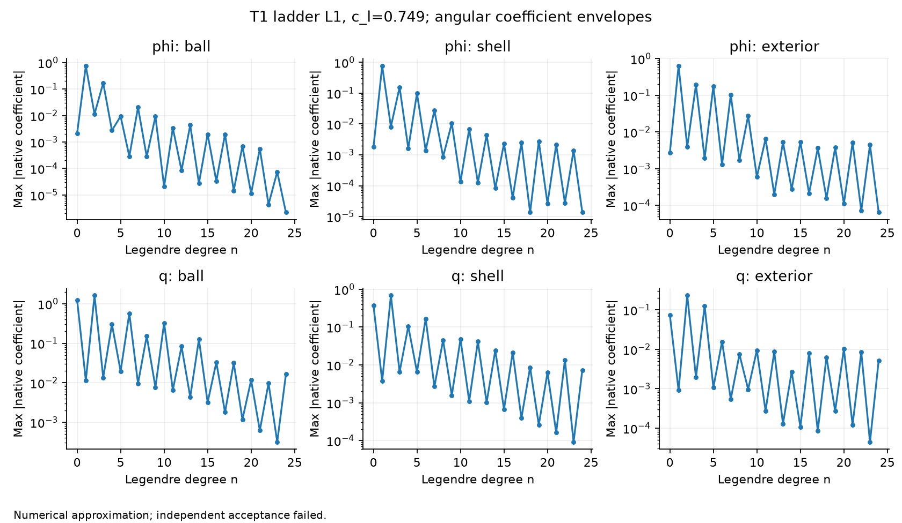
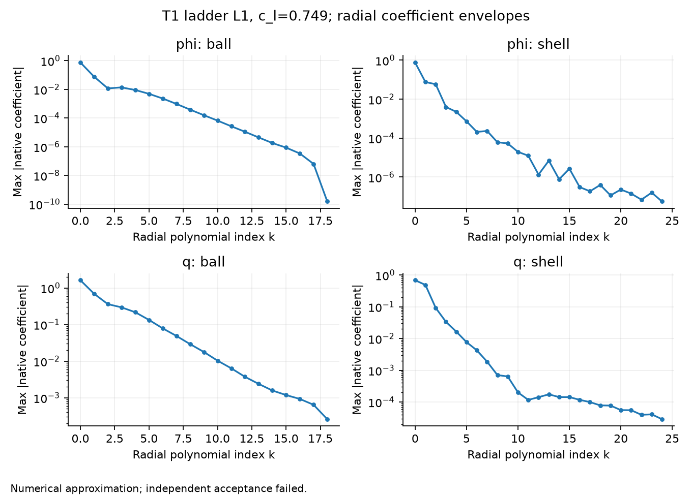
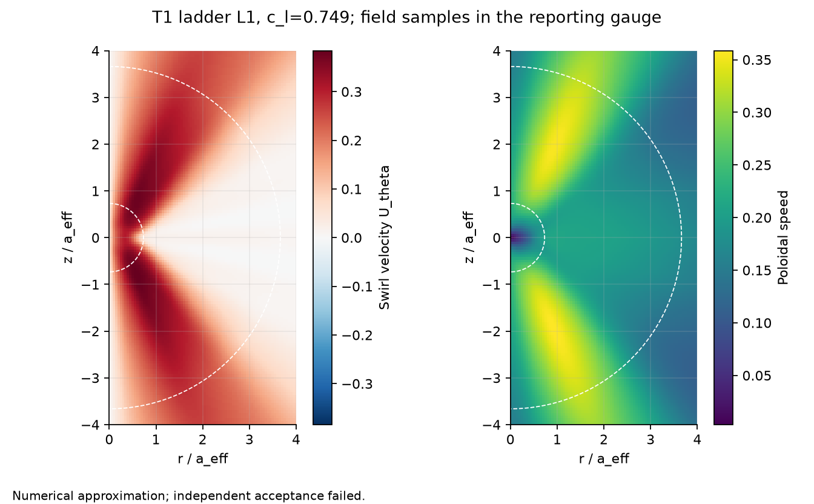
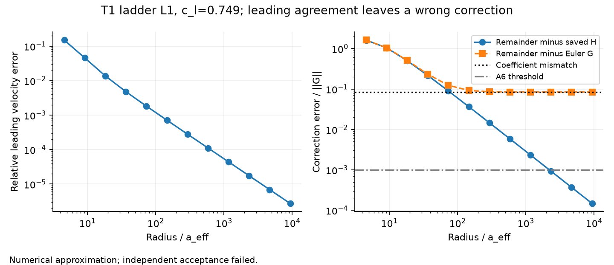
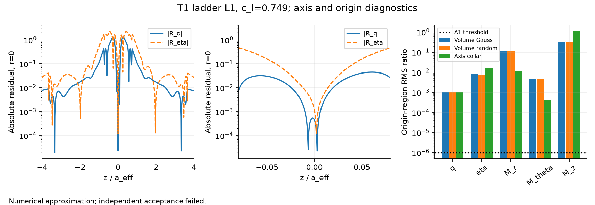
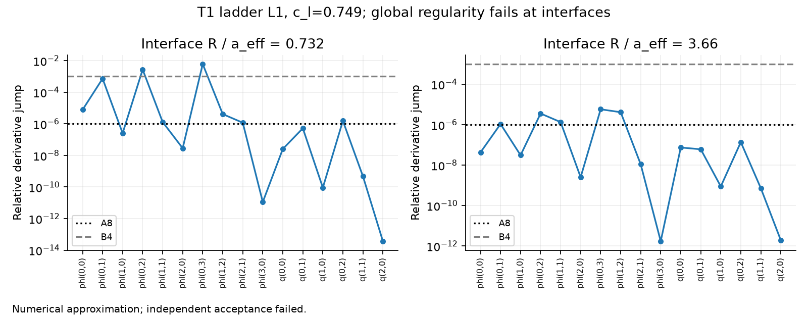
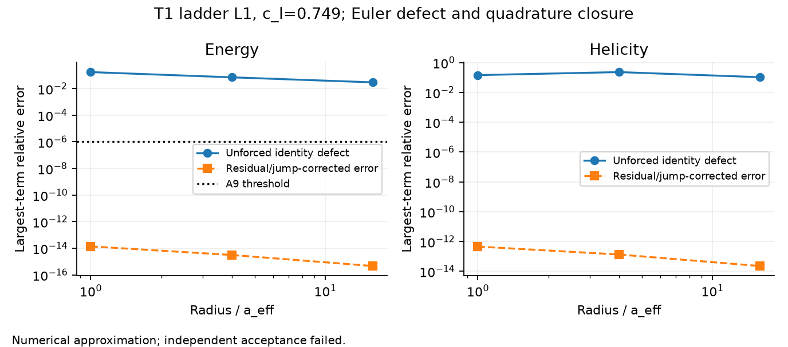
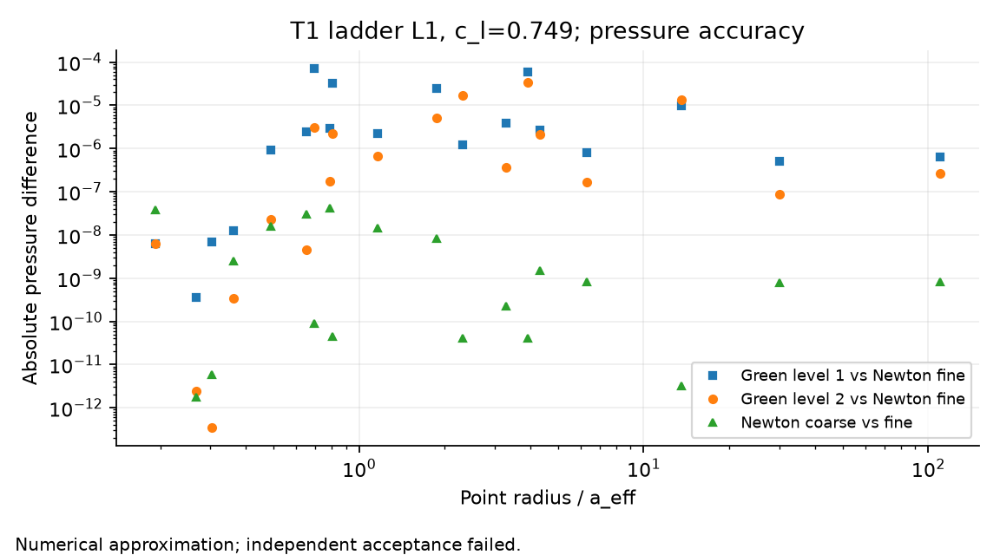

# Frozen ladder diagnostic figures

## registered_radius

All 18 dyadic shells, with origin excluded here. Momentum is the maximum of the three component ratios at each displayed set, not the auxiliary vector ratio.

## angular_coefficients

The envelope is max over radial columns in the saved native basis. Element normalizations differ. This is not a physical energy spectrum.

## radial_coefficients

Ball radial indices depend on angular degree through the total-degree cutoff. The exterior has distinct powers, not a polynomial-degree ladder, and is omitted.

## field_distribution

Independent values on an 81 x 145 meridional grid. White dashed arcs mark element interfaces; visual smoothness does not establish global regularity.

## far_field

Full-sphere L2 norms. The first remainder uses the prescribed exponent 2 alpha + 1. The horizontal mismatch comes from saved coefficients, not a fitted asymptote.

## axis_origin

The first panels are unnormalized exact-axis reduced residuals. The final panel uses the registered origin-region denominators. A low origin defect does not control the rest of the axis.

## interface_jumps

Labels field(d_R,d_mu) give derivative orders. Every ratio uses the largest one-sided value of that derivative as its scale. Axis regularity inside the elements cannot remove these jumps.

## balances

Fine quadrature results normalized by the largest absolute balance term. Residual work and interface flux jumps account for the raw defect; their inclusion does not make the field an unforced solution.

## pressure

Twenty retained points; coincident radii can have different angles. Absolute working-coordinate pressure differences do not by themselves give the shell-relative A7 criterion.

